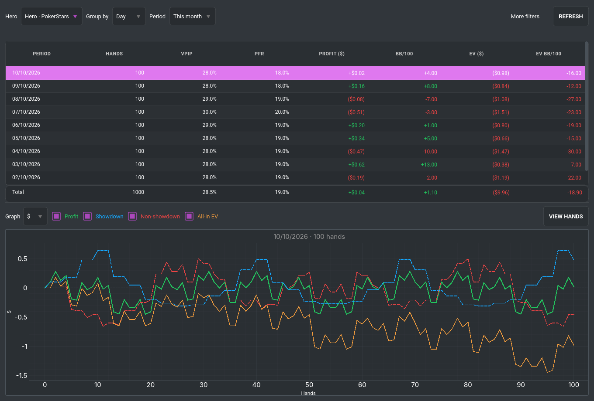
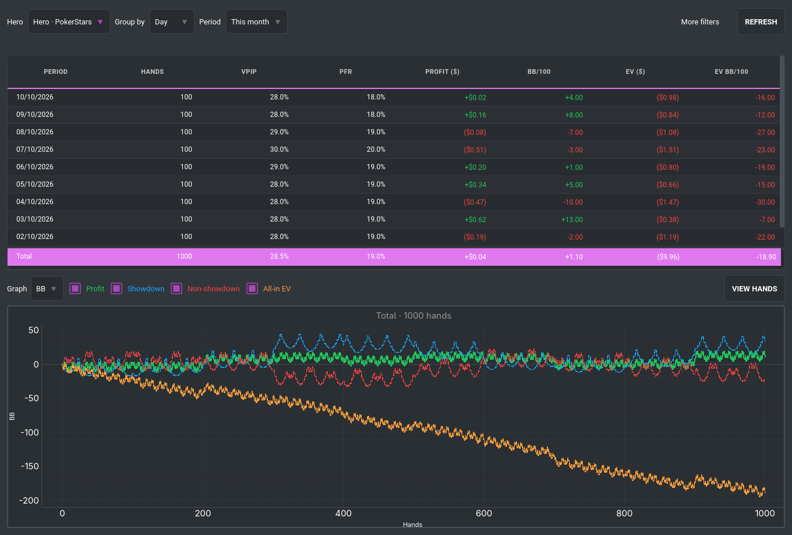
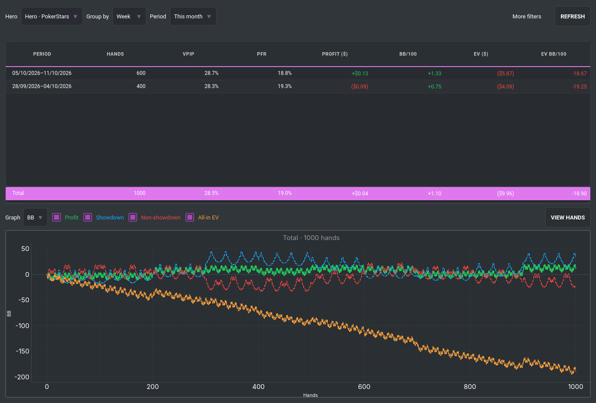

# Resultados por dia, semana, mês e ano

## Abrir e usar

Reabra o FPDB e escolha **Cash → Results**, ou use **Ctrl+R**. A aba é única:
abrir novamente volta à mesma tela, preservando filtros e seleção.

O padrão é o Hero configurado, agrupamento **Day** e intervalo **This month**.
Não há agrupamento, coluna ou seletor de moeda. Esta primeira versão apresenta
as mãos **cash em USD**, com os gráficos em dólares ou BB.

1. Escolha **Day / Week / Month / Year** em **Group by**.
2. Escolha o intervalo em **Period**: hoje, ontem, últimos sete dias, mês,
   ano, todo o histórico ou datas personalizadas.
3. Clique numa linha para visualizar o gráfico daquele período.
4. Clique na linha fixa **Total** para visualizar todo o intervalo filtrado.
5. Use **View hands**, ou dê duplo clique num período, para abrir suas mãos no
   visualizador existente. Dali, abra as mãos desejadas no replayer.

**More filters** oferece modalidade e limite. **Refresh** consulta novamente
o banco, incluindo importações recentes, preservando o período selecionado
quando ele continua disponível. Datas personalizadas são aplicadas com Refresh.

## Tabela

| Coluna | Definição |
| --- | --- |
| Period | Dia, intervalo semanal, mês ou ano |
| Hands | Mãos do Hero no período e nos filtros ativos |
| VPIP | Soma de `street0VPI` / soma de `street0VPIChance` |
| PFR | Soma de `street0Aggr` / soma de `street0AggrChance` |
| Profit ($) | Resultado líquido armazenado nas mãos, convertido de centavos |
| bb/100 | Soma do resultado em BB de cada mão / mãos com blind válido × 100 |
| EV ($) | Resultado ajustado pelo all-in EV armazenado |
| EV bb/100 | Soma do EV em BB de cada mão / mãos com blind válido × 100 |

Os totais são calculados das contagens e resultados originais, nunca por média
simples dos percentuais ou win rates das linhas. Limites diferentes são
normalizados pelo big blind de cada mão. Os valores monetários conservam a
precisão Decimal até a apresentação.

## Gráfico

As quatro curvas começam em zero e seguem as mãos por horário e ID:

- **Verde — Profit:** lucro/prejuízo acumulado.
- **Azul — Showdown:** resultado líquido das mãos em que o Hero viu showdown.
- **Vermelho — Non-showdown:** resultado líquido das outras mãos do Hero.
- **Laranja — All-in EV:** resultado acumulado com os ajustes de all-in disponíveis.

Showdown + non-showdown somam o lucro total em cada ponto. O último ponto das
curvas de lucro e EV coincide com a linha selecionada da tabela. Os controles
coloridos permitem ligar/desligar curvas; **$ / BB** altera somente a unidade
do gráfico. A linha de EV zero permanece visível quando esse é o valor real.

EV não é previsão de lucro nem EV de todas as decisões: usa `HandsPlayers.allInEV`.
Quando o valor armazenado é NULL, usa o resultado realizado; zero verdadeiro
é preservado. Nas mãos sem ajuste calculado, o FPDB normalmente armazena o
próprio resultado realizado.

## Calendário e população

- O dia vira à **meia-noite no fuso local do sistema**.
- Semana: segunda a domingo, inclusive nas semanas que cruzam a virada do ano.
- Meses e anos seguem o calendário.
- Datas SQL são limites UTC derivados das meias-noites locais, com início
  inclusivo e fim exclusivo; transições de horário de verão são respeitadas.
- Agrupamento e intervalo são independentes. **This year + Month** mostra
  os meses do ano; **This month + Day** mostra os dias do mês.
- Um bucket semanal/anual pode conter somente a parte alcançada pelos filtros.
- Taxas BB ficam indisponíveis sem blind utilizável. Se uma seleção contém
  blinds inválidos, o gráfico BB não mistura silenciosamente mãos incompletas;
  os resultados monetários permanecem disponíveis.

## Reaproveitamento

- Dados existentes de `Hands`, `HandsPlayers` e `Gametypes`; sem novas tabelas
  ou mudanças no importador.
- `ProfitGraphWidget` existente, com unidades/título configuráveis e quatro curvas.
- `DbWorker` existente, agora também aceitando parâmetros SQL vinculados.
- Visualizador de mãos existente, com sua paginação e acesso ao replayer.
- Consultas antigas de gráficos corrigidas para BB verdadeiro: removida a
  divisão por `2 × bigBlind`, alinhando a unidade ao relatório de sessões.

## Verificação

- **93 testes direcionados aprovados**: agrupamentos, contagens, taxas,
  UTC/meia-noite/DST, zero/NULL de EV, limites mistos, gráficos, seleção após
  ordenação, troca entre dia e Total, refresh, workers obsoletos, navegação,
  conexões, menus e compatibilidade com estatísticas/gráficos existentes.
- Ruff aprovado nos arquivos alterados. Mypy aprovado nos dois módulos novos
  com o alvo Python 3.13 usado nesta instalação.
- **911 mãos cash USD reais** verificadas: totais, VPIP/PFR, bb/100 e EV bb/100
  coincidem com SQL independente; os quatro agrupamentos conservam mãos e dinheiro.
- As quatro curvas e a unidade BB foram reconferidas com esses dados reais.
  Três mãos reais recentes foram abertas no visualizador existente.
- As capturas abaixo usam exclusivamente dados sintéticos públicos,
  sem abrir ou publicar o banco pessoal.

```bash
QT_QPA_PLATFORM=offscreen .venv/bin/python tools/capture_results_review.py \
  --out /tmp/results-review
```






