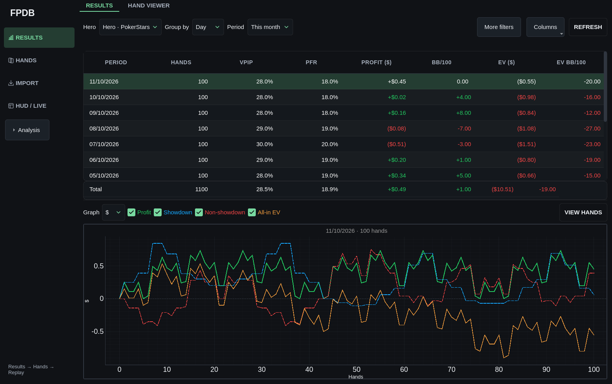
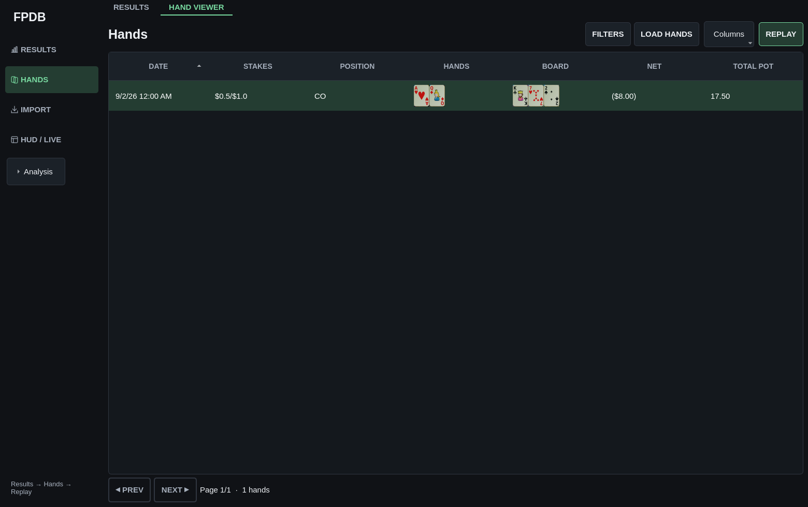
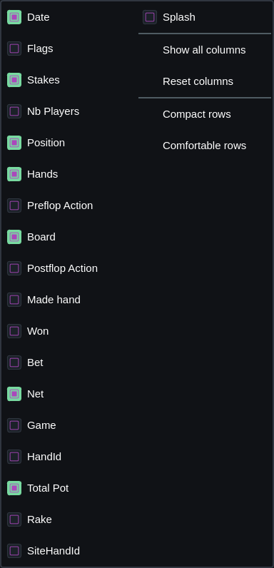
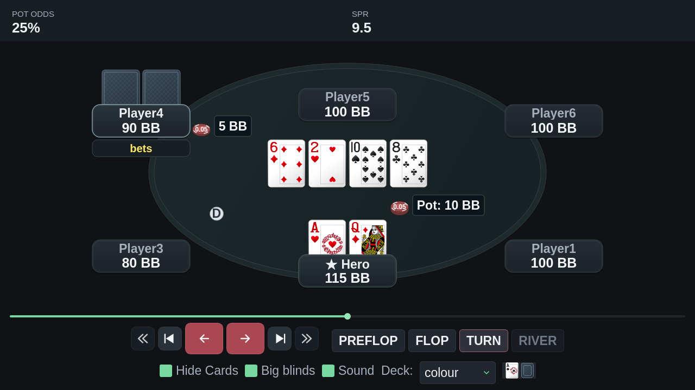

# Identidade visual e UX da aplicação

## Referências pesquisadas

- [GTO Wizard — Hand History Analyzer](https://help.gtowizard.com/how-to-use-the-hand-history-analyzer/):
  lista de mãos como foco, filtros próximos, revisão direta e opções de densidade.
- [GTO Wizard — Aggregate Reports](https://help.gtowizard.com/aggregate-reports-guide/):
  tabelas e gráficos com seleção/filtros coerentes, agrupamentos e cores semânticas.
- [Linear — redesign da interface](https://linear.app/now/how-we-redesigned-the-linear-ui):
  superfícies neutras, alinhamento, hierarquia e redução de ruído visual.
- [Carbon — data tables](https://carbondesignsystem.com/components/data-table/usage/):
  ordenação, toolbar, paginação e apresentação secundária de informações.
- [Carbon — eixos e labels](https://carbondesignsystem.com/data-visualization/axes-and-labels/):
  unidades explícitas e escalas adequadas ao tipo de gráfico.
- [Nielsen Norman Group — progressive disclosure](https://www.nngroup.com/articles/progressive-disclosure/):
  funcionalidades frequentes visíveis e detalhes especializados acessíveis sob demanda.

Os padrões foram implementados em Qt com estilos/ícones próprios. O replayer
aprovado continua sendo a referência de cores e acabamento.

## Implementação

- Design system compartilhado em `design_system.py`, integrado ao ThemeManager.
- Paleta perceptual grafite/menta, superfícies graduais, bordas finas e foco claro;
  fundamentação, cores exatas e medições em [COLOR_SYSTEM.md](COLOR_SYSTEM.md).
- Verde menta **`#83caa4`**, com saturação contida.
- Seleção em verde escuro, preservando contraste e legibilidade dos resultados.
- Textos **25% maiores**, inclusive estilos locais e rich text, com aplicação
  idempotente: atualizar o tema não multiplica novamente os tamanhos.
- Tipografia e unidades dos gráficos acompanham a política compartilhada.
- Navegação lateral: Resultados, Mãos, Importação e HUD/Live; análises recolhíveis.
  Menus e atalhos continuam acessíveis.
- Tabelas com controle de colunas no clique direito do cabeçalho; preferências
  persistentes, restauração do padrão, exibição completa e densidade de linhas.
- Hand Viewer cash com sete colunas iniciais: data, stakes, posição, cartas,
  board, resultado líquido e pote. Flags, IDs, número de jogadores e detalhes
  ficam disponíveis em **Columns**, sem remover os dados do modelo.
- Toolbar de mãos com **Filters**, **Load hands**, **Columns** e **Replay**.
  Filtros e flags especializados ficam recolhidos inicialmente.
- Cartas do Hand Viewer cash usam badges compactos de rank/naipe, com superfície
  grafite intermediária e naipes de alto contraste, inclusive na seleção. As colunas mantêm
  largura de conteúdo ao alternar entre abas.
- Menus de selects ajustam a largura às opções completas, incluindo margens do
  tema, sem exigir que o campo fechado ocupe a mesma largura do menu.
- Ordenação do Hand Viewer ocorre sobre todos os IDs antes da paginação. Data,
  cartas, board e valores financeiros usam metadados leves; colunas de ações
  são reconstruídas sob demanda. O replayer recebe a lista completa nessa ordem.
- Resultados inclui **Reset view**, que restaura os limites do gráfico após zoom
  ou deslocamento, preservando o período e as curvas selecionadas.
- Visualizador de torneios também usa colunas essenciais por padrão.
- Resultados oferece **Columns**, sincronizando colunas ocultas com a linha Total.
- Cartas do replayer **25% maiores nominalmente**, com arredondamento para pixels
  inteiros; cartas lado a lado, bases atrás das placas e apostas dentro do feltro.

## Verificação

- Correções de tabela/gráfico: **23 testes direcionados aprovados**, incluindo
  ordenação financeira entre páginas e restauração do gráfico após zoom/pan.
  Capturas públicas atualizadas conferidas em `/tmp/opencode/design-review-fixed`.
- **313 testes direcionados aprovados**: temas/persistência, aplicação repetida,
  navegação, colunas, preferências, filtros, gráficos, resultados, controles,
  variantes, ampliação das cartas e colisões entre apostas/elementos visíveis.
- Ruff e mypy aprovados nos módulos novos (Python 3.13 da instalação).
- **1.691 mãos cash USD reais** reconferidas contra SQL independente: totais,
  VPIP/PFR, bb/100, EV bb/100 e curvas conservados; três mãos recentes abertas
  no visualizador existente.
- **25 replays recentes**, **852 frames** e **2.064 grupos de aposta/pote**
  conferidos após a ampliação: todos dentro do feltro e sem colisões.
- Capturas Qt abaixo usam somente mãos públicas/sintéticas.

```bash
QT_QPA_PLATFORM=offscreen PYTHONPATH=. .venv/bin/python tools/capture_design_review.py --out /tmp/design-review
```








