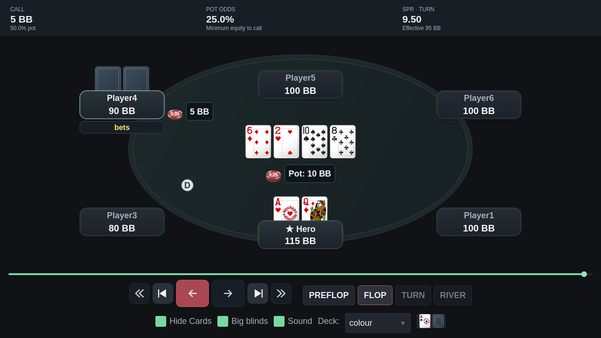
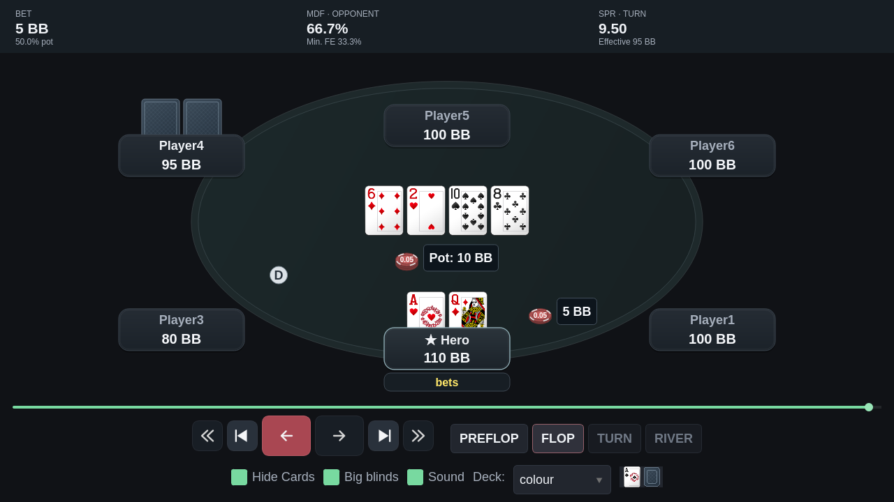
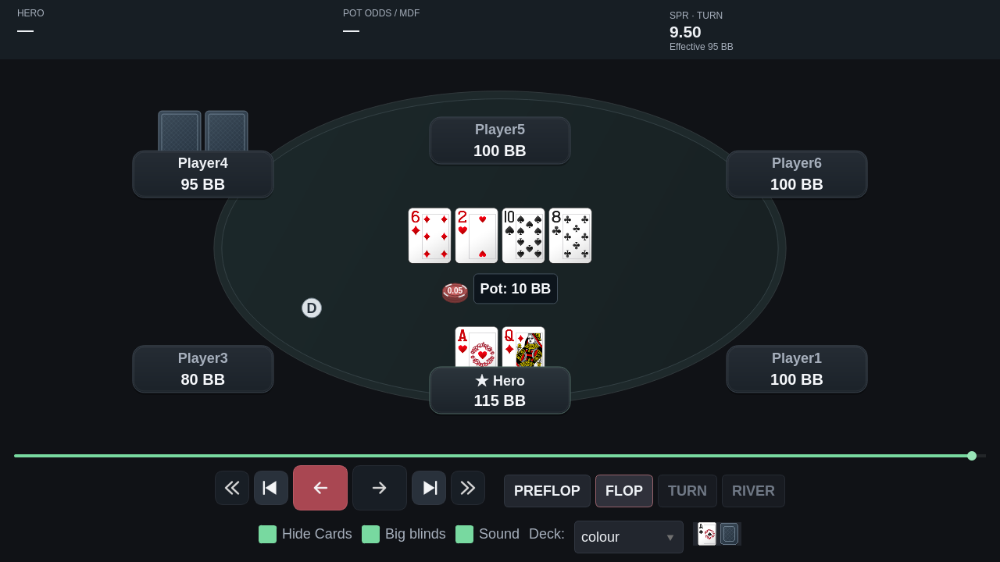

# Replayer simplificado: mesa e faixa de decisão

## Organização

O replayer mostra a faixa de decisão no topo, a mesa e os comandos embaixo.
O header visual antigo foi removido integralmente: modalidade/stake, site, ID da mão, resumo de ação,
contagem de passos, dicas e os botões Actions/Share/Solver review. A timeline
lateral também deixa de ocupar a janela larga.

A superfície ocupa toda a largura e encosta no topo e nas laterais, sem
margem externa, borda ou cantos arredondados. O texto mantém espaçamento interno.

A faixa de decisão fica no topo da janela, em três posições fixas:

1. **Contexto:** call, bet ou investimento novo do raise, com sizing em % do pote.
2. **Decisão:** pot odds ao enfrentar uma aposta; MDF do adversário e fold equity
   mínima quando o Hero aposta.
3. **SPR:** sempre visível como campo, identificado pela street e acompanhado
   do stack efetivo usado no cálculo.

As cartas lado a lado atrás das placas, as pilhas separadas, a contenção de
apostas/potes no feltro e os controles manuais continuam compondo a mesa.

## SPR da street atual

`SPR = stack efetivo no início da street / pote no início da street`

O número é calculado novamente ao entrar no flop, turn ou river e permanece
estável durante as apostas dessa street. Por exemplo, no turn com pote de
10 BB e stack efetivo de 95 BB, aparece **SPR · TURN = 9,50**, tanto antes
quanto depois de uma aposta.

- Heads-up: menor stack entre Hero e adversário no início da street.
- Multiway: faixa dos SPRs efetivos por adversário ainda vivo no início da
  street, explicitamente identificada como multiway. O tooltip lista os
  adversários e seus stacks efetivos.
- Dinheiro de jogadores foldados continua compondo o pote, mas seus stacks
  não definem um confronto efetivo.
- Ao concluir a mão ou foldar, as métricas de decisão são limpas; o SPR da
  street permanece como referência histórica quando pode ser calculado.
- Sem pote ou confronto efetivo, o campo mostra `—`, sem divisão fictícia.

## Pot odds, sizing, MDF e FE mínima

**Pot odds** é a equidade mínima requerida para pagar:

`call / pote elegível após o call × 100`

O call é limitado ao stack disponível do Hero. Em all-ins/side pots, o cálculo
exclui dinheiro de camadas que o Hero não pode ganhar. Exemplo: enfrentar
5 BB num pote atual de 15 BB dá **25%**, pois o pote após o call será 20 BB.

**Sizing** usa o investimento novo da ação dividido pelo pote imediatamente
anterior. Num raise, esse investimento inclui o componente de call e não
conta novamente fichas já apostadas pelo Hero. O rótulo identifica isso como
`RAISE · NEW INVESTMENT`.

Para uma aposta heads-up, com `P` sendo o pote anterior e `B` o investimento
adicional em risco:

- `MDF = P / (P + B) × 100`
- `FE mínima do blefe sem equidade = B / (P + B) × 100`

Uma aposta de 5 BB em pote de 10 BB mostra **50% pote**, **MDF 66,7%** e
**FE mínima 33,3%**. Para raises, usa-se a mesma convenção explícita do
investimento adicional sobre o pote anterior; excesso que não pode ser
pago pelo adversário não aumenta o risco efetivo.

O MDF individual não é calculado para multiway. São thresholds puramente
matemáticos, sem estimar ranges, equidade de cartas ou ajustes estratégicos.
Todos os cálculos usam somente o estado exibido e os estados anteriores.

## Verificação

- **242 testes direcionados aprovados**, incluindo regressões de controles,
  cartas, fichas, BB, fold, variantes, compartilhamento e revisão de mãos.
- A mudança da faixa para o topo foi validada com **144 testes direcionados**
  de layout, integração Qt e posicionamento de fichas; capturas atualizadas e Ruff aprovado.
- Dez casos aritméticos verificam SPR no flop/turn/river, estabilidade durante
  apostas, pot odds, MDF, raises, all-ins, side money, multiway, folds e ausência
  de informação futura.
- Teste Qt confirma as três apresentações do turn: SPR sem decisão, MDF após
  bet e pot odds ao enfrentar aposta, sem executar cálculos de equidade de cartas.
- Testes confirmam que header e timeline não são desenhados e a faixa pertence
  ao topo da janela, acima da mesa. Ruff e mypy aprovados nos módulos alterados.
- **25 mãos reais recentes**, **944 frames** e **2.306 grupos de aposta/pote**
  reconferidos: todos dentro do feltro e sem colisão com os elementos reservados.
- Capturas públicas em 1280×720, 1600×900 e 1260×1380; os três cenários de
  decisão são sintéticos e não acessam o banco pessoal.

```bash
QT_QPA_PLATFORM=offscreen .venv/bin/python tools/capture_replayer_review.py \
  --out /tmp/replayer-decisions --big-blinds --decision-cases \
  --side-pots --polish-cases \
  --pokerstars-path "/caminho/absoluto/para/PokerStars"
```






