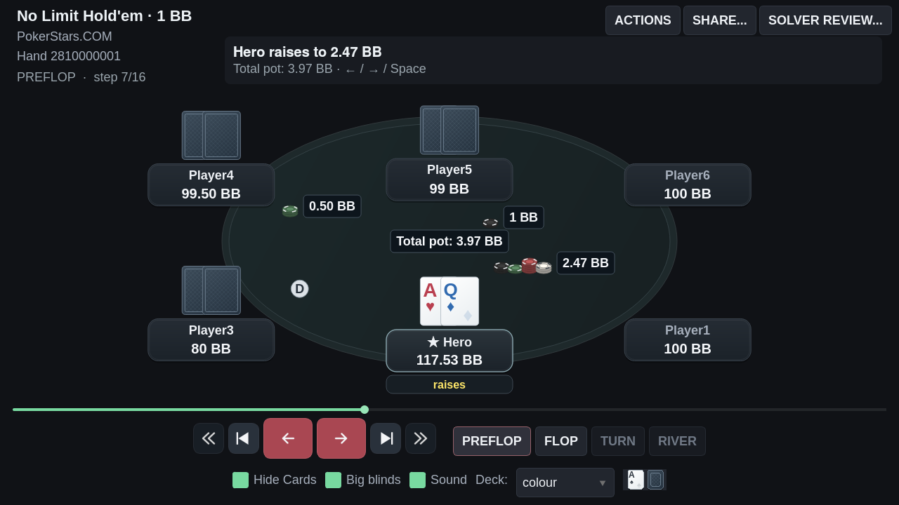
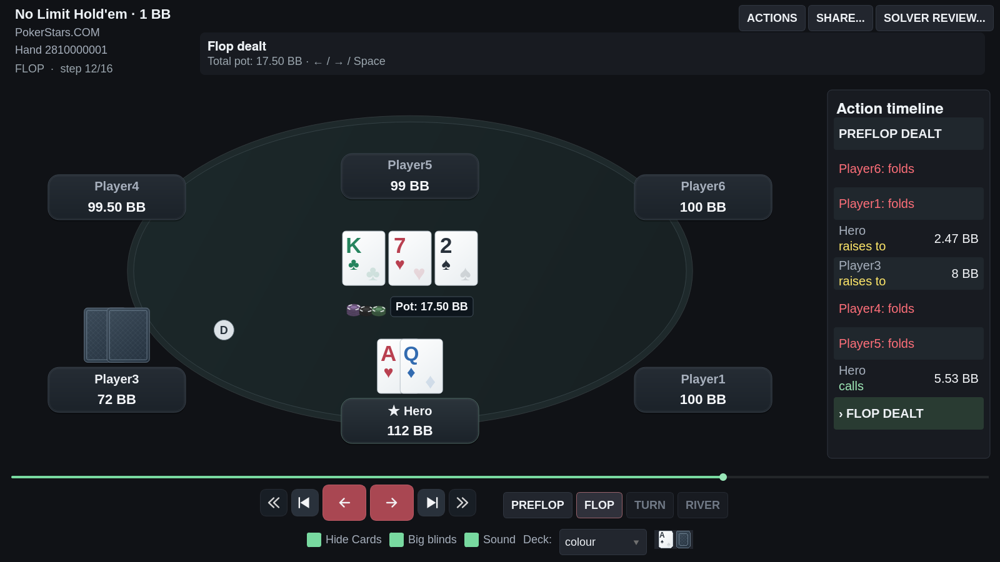
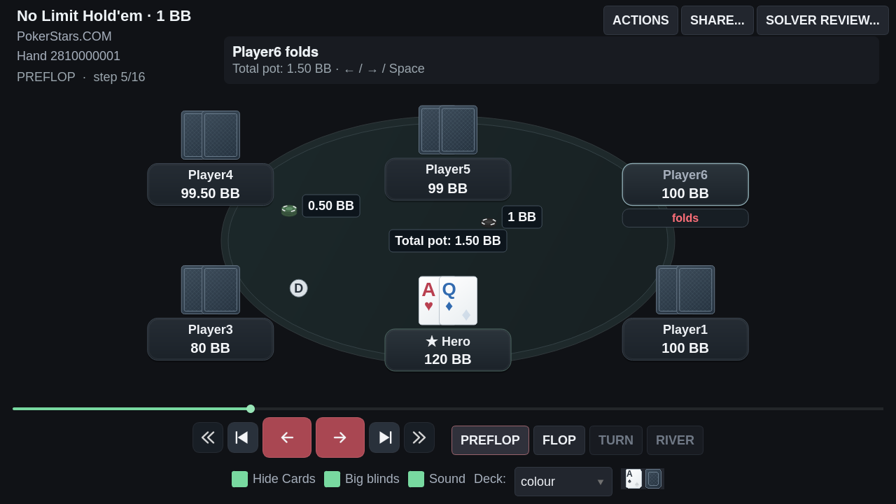

# Acabamento do replayer: assentos, cartas e fold

## Referência e direção

O feedback comparou o replayer com o PokerStars: o acabamento depende de uma
composição coerente de cartas, nick e stack, não apenas da paleta de cores.
Esta revisão usa placas compactas, profundidade discreta e informação centralizada,
preservando a clareza de uma ferramenta de estudo moderna.

## Mudanças

- Nick centralizado na linha superior, com toda a largura disponível.
- Stack destacado abaixo; não há mais uma segunda linha vazia reservada à ação.
- Cartas acima da placa em todos os assentos, com espaçamento e alinhamento comuns.
- Identidade de Hero, ação atual e vencedor com tratamentos distintos e discretos.
- Badge de ação somente quando relevante; resultados financeiros continuam explícitos.
- Na conclusão, o stack visual inclui o prêmio recebido, sem alterar o estado
  canônico que guarda as fichas ganhas separadamente.
- Cartas colour com índices dentro da faixa exposta pela sobreposição, margens
  ópticas, sombreamento de papel e naipes complementares discretos.
- Versos padronizados, sem a marca “FP” cortada pela sobreposição.
- Proporção da mesa adaptada moderadamente à janela vertical, preservando as
  dimensões das cartas e o espaço dos controles.

## Fold

- Retirada de 200 ms, com deslocamento curto para dentro e fade até zero.
- Sem o giro exagerado ou o passeio sobre o centro da mesa.
- Ao terminar, cartas descartadas não permanecem como fantasmas sobre o feltro.
- Saltos/reversões, busca no histórico e troca de mão limpam as animações.
- O descarte de jogos de draw mantém sua duração própria.
- A opção de revelar cartas conhecidas permite estudar mãos já foldadas;
  não inventa cartas de adversários desconhecidas.

## Revisão e verificação

Um agente implementou o acabamento dos assentos/cartas e outro avaliou capturas
em contexto separado. A revisão confirmou maior coesão e identificou uma colisão
residual das fichas ganhas com o dealer. A correção usa os retângulos do board
realmente pintados, evitando tratar espaços vazios como cartas ocupadas.

- 149 testes direcionados aprovados: layout, nomes longos, stack final, variantes,
  controles manuais, BB, fichas, fold, áudio, equidade, compartilhamento e solver review.
- Ruff e mypy aprovados.
- Sete efeitos originais carregados e transições de 25 mãos reais verificadas.
- Capturas de 1280×720, 1600×900 e 1260×1380; captura em escala HiDPI 1,5×.

Os frames de fold usam um relógio controlado para reprodução visual. O término e
a limpeza da animação também são testados com o event loop real do Qt.

```bash
QT_QPA_PLATFORM=offscreen .venv/bin/python tools/capture_replayer_review.py --out /tmp/replayer-finish --big-blinds --polish-cases --side-pots
```

Todas as capturas usam dados públicos de teste, sem o banco pessoal.






