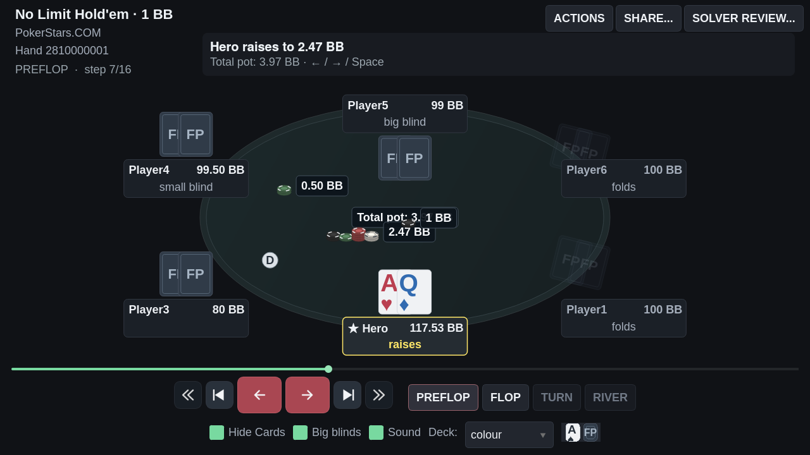
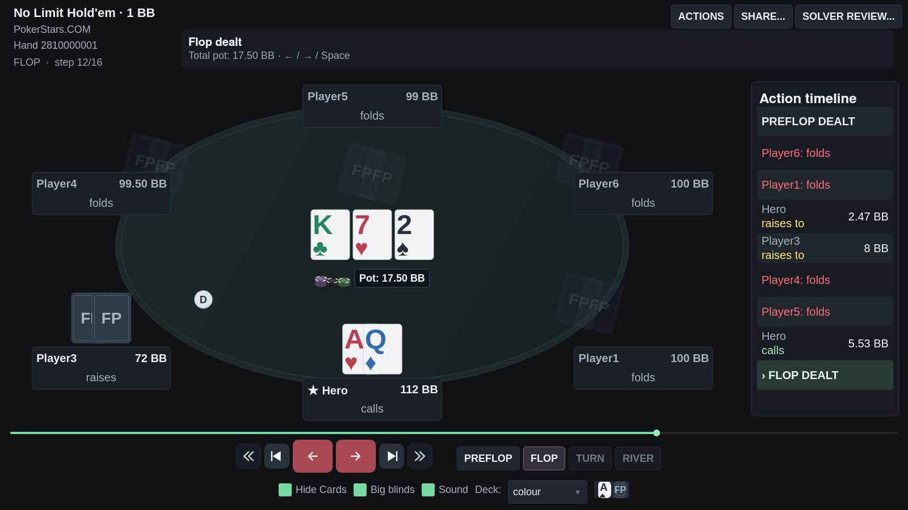
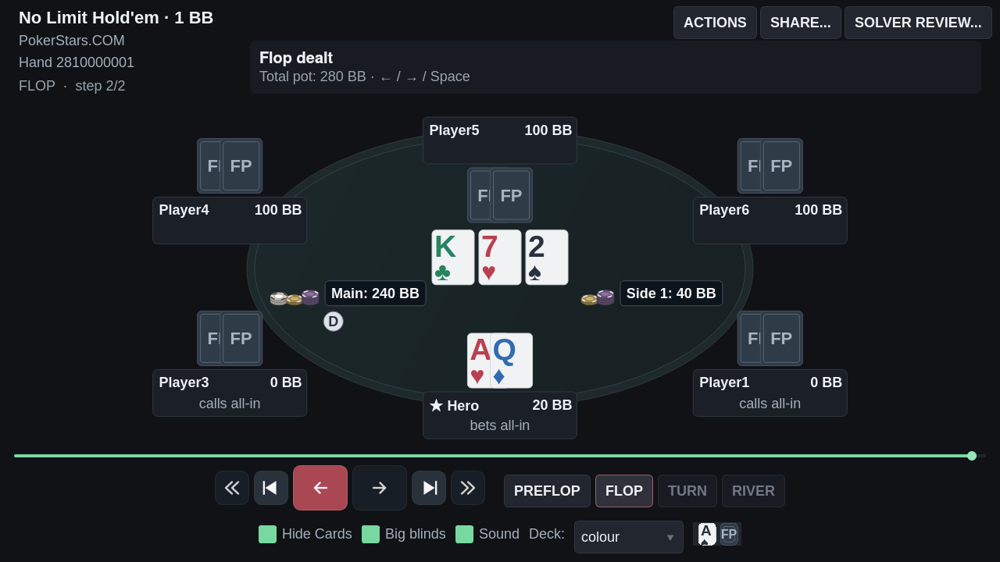

# Replayer manual: controles, big blinds e fichas

## Mudanças solicitadas

- Controles por ícones: mão anterior, início, ação anterior, ação seguinte, fim e
  próxima mão. As duas setas de ações são os controles principais.
- Sem Play/Pause ou reprodução automática. Space avança exatamente um passo;
  Left/Right voltam/avançam, Home/End saltam aos extremos e Up/Down mudam de mão.
- Feedback imediato de hover/press, mais uma animação curta do ícone. A área de
  clique não se move; a ação ocorre pela liberação nativa do botão.
- Preflop/Flop/Turn/River mantidos como atalhos secundários.
- Som local fixo em 100%, preservando apenas o toggle Sound. O volume do sistema
  operacional continua independente.
- Fontes do replayer ampliadas em 50%; ranks e naipes do deck colour maiores.
  As dimensões externas das cartas usam a mesma referência de viewport anterior.
- Checkbox Big blinds para stacks, apostas, potes, ganhos e ações do histórico.
  A preferência fica salva. Uma variante sem big blind utilizável não oferece
  uma conversão fictícia; porcentagens e razões de equidade permanecem nessas unidades.
- Valores de apostas/potes em branco sobre superfície escura, acompanhados de fichas.

## Representação das fichas

`replayer_chips.py` decompõe os valores reais em denominações proporcionais a
1/5/25/100/500/2500/… unidades. Cada pilha contém 1–4 fichas; denominações maiores
são acrescentadas quando necessário. A soma das denominações e quantidades é
exatamente o valor original, incluindo frações finas e unidades de torneio.

A unidade mínima é consistente na mão. Alterar para BB muda os rótulos, não os
estados ou os valores físicos das fichas. Um tooltip mostra a composição de
denominações de cada grupo.

As apostas em andamento ficam diante dos assentos. Pilhas centrais mostram somente
fichas recolhidas da rodada; o valor Total pot pode incluir apostas ainda nos
assentos sem duplicar essas fichas no centro. Main e Side identificam os potes
derivados do modelo existente. Na conclusão, a pilha recebida aparece diante do
vencedor, com espaço reservado para cartas e botão do dealer.

## Verificação direcionada

- 133 testes direcionados aprovados: estados, geometria, cartas, navegação,
  feedback de clique, BB, fichas, áudio, equidade, Stud Hi/Lo, compartilhamento
  e revisão preflop.
- Conversão em BB verificada também com blind 0,02, não apenas com o blind unitário
  usado na captura de demonstração.
- Teste de side pots: 240 no main e 40 no side, com 20 de aposta não paga devolvidos.
- Teste de ausência de avanço automático e volume fixo, incluindo uma preferência
  antiga de volume baixo.
- Teste de liberação da área do dealer e dos slots de cartas para as fichas ganhas.
- Ruff e mypy aprovados nos módulos alterados.

Revisão visual independente encontrou e motivou a correção de uma colisão com
o dealer e de uma quantia truncada no histórico. Os valores agora têm uma coluna
própria no histórico lateral.

## Capturas reproduzíveis

```bash
QT_QPA_PLATFORM=offscreen .venv/bin/python tools/capture_replayer_review.py --out /tmp/replayer-cash --side-pots
QT_QPA_PLATFORM=offscreen .venv/bin/python tools/capture_replayer_review.py --out /tmp/replayer-bb --big-blinds --side-pots
```

A fixture é pública; o cenário extra de side pots é sintético e conservado.
O script não conecta ao banco pessoal e não altera a preferência salva de BB.






