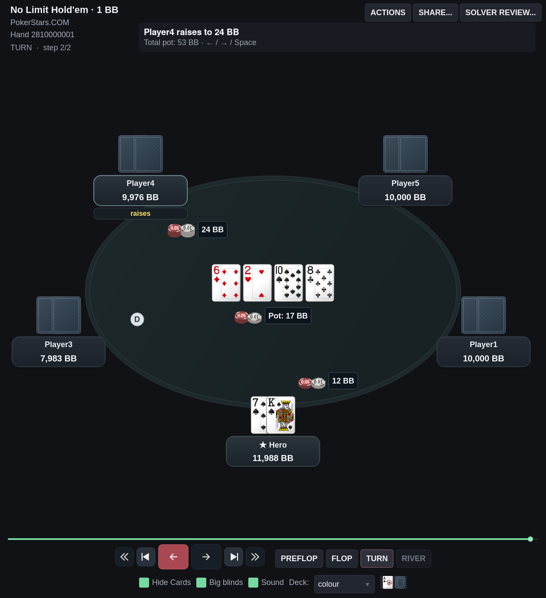
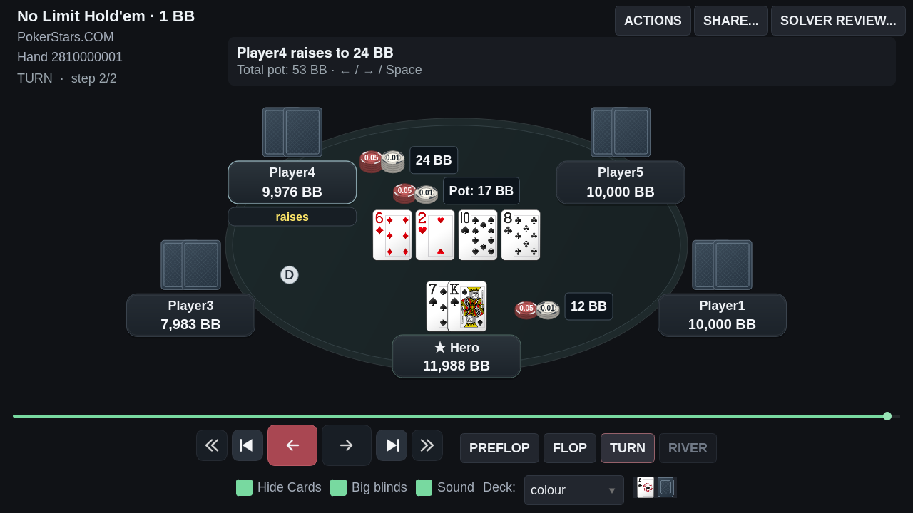
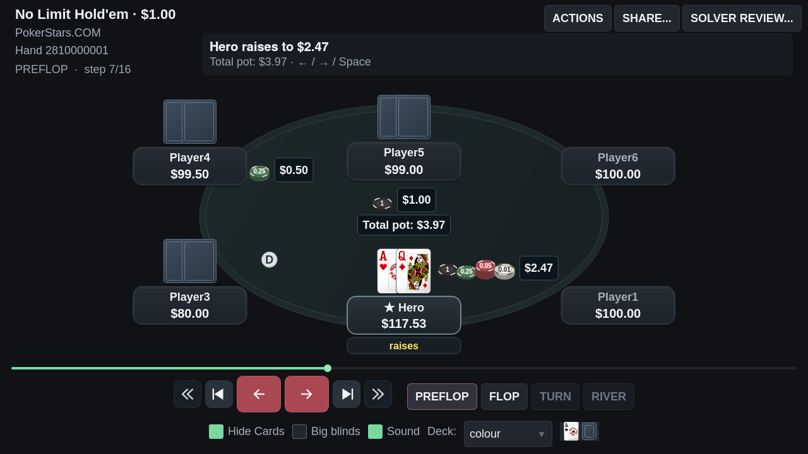
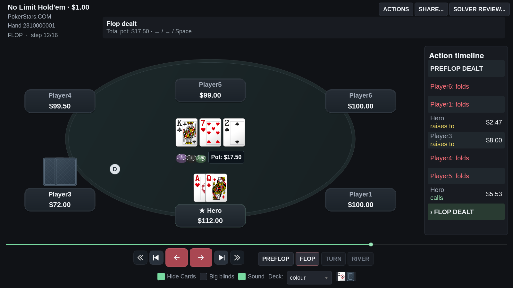
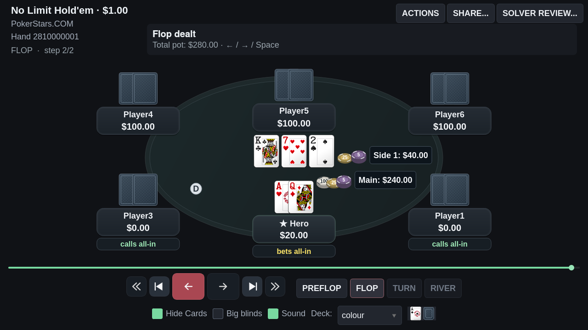

# Cartas PokerStars e apostas por assento

## Refinamento de 10 de outubro de 2026

Esta etapa responde ao pedido de cartas com pips e figuras completas, fichas
mais legíveis e identificação inequívoca do dono de cada aposta.

- A geometria das apostas parte do assento efetivamente desenhado, incluindo
  os ajustes de posição em janelas estreitas.
- Sem linhas entre aposta e jogador: a ligação pontilhada da primeira versão
  desta etapa foi removida após a revisão visual do usuário.
- A aposta do assento inferior fica ao lado das suas cartas, preservando a
  faixa central para o pote e para o jogador de cima.
- As apostas são desenhadas depois de todos os assentos, reservando cartas
  (inclusive elevadas ou animadas), placas, badges de ação/resultado, combinações,
  todos os dealers, board, pote, outras apostas e timeline. A área disponível
  também exclui o cabeçalho e os controles.
- Se os desvios próximos estiverem ocupados, o posicionador busca áreas livres
  nas bordas dos obstáculos; não retorna ao ponto original sobre um elemento.
  Em espaços muito estreitos, prioriza o rótulo do valor exato sobre as pilhas
  decorativas, mantendo a decomposição disponível no tooltip.
- O total do pote pré-flop reserva espaço abaixo da aposta do assento superior.
- O grupo inteiro (pilhas e rótulo) deve caber no oval interno do feltro,
  com margem em relação à borda. A verificação considera os quatro cantos,
  e não apenas o centro do grupo ou o retângulo que envolve a mesa.
- As posições válidas são ordenadas pela distância ao ponto do assento,
  incluindo a borda curva: isso evita deslocar a aposta para outro jogador
  quando existe um espaço mais próximo dentro da mesa.
- Potes centrais e side pots usam as mesmas restrições e são desenhados após
  reservar cartas, placas, badges e dealers. Em mesas muito densas, o rótulo
  compacto conserva o valor exato dentro do feltro.
- Fichas de 32 px, com bordas segmentadas, profundidade e denominação impressa.
  A decomposição continua exata; os valores impressos são unidades canônicas,
  enquanto o rótulo do total acompanha o modo monetário ou BB.
- Volume local fixo em **50%**, substituindo os 100% da etapa anterior, com
  o controle **Sound** para ativar/silenciar.

## Faces completas

O deck **colour** agora usa as faces originais do cliente PokerStars configurado
em `site_path`, lidas diretamente de
`Gx/table-view/cards/default/1440/cache/<rank><suit>.png`.
Isso inclui todos os pips das cartas numéricas e as figuras de J, Q e K.
A suavização de imagem e a sombra discreta integram as faces à mesa, preservando
as dimensões externas das cartas, a sobreposição e o verso do FPDB.

Quando uma face local não está disponível, o replayer usa o deck SVG `white`
existente no projeto (Nicu Buculei/Open Clip Art Library, domínio público indicado
nos metadados dos SVGs). Os arquivos originais do cliente são somente lidos e
não são distribuídos no fork. As imagens abaixo são capturas da interface,
com uma mão pública de teste.

## Verificação

- **213 testes direcionados aprovados**, incluindo layout, BB, fichas exatas,
  fold, variantes, controles, áudio, equidade, compartilhamento e solver review.
- Ruff aprovado nos arquivos alterados; mypy aprovado nos módulos de cartas,
  fichas e áudio.
- As **52 faces locais** coincidem com as imagens originais do PokerStars.
- As **52 faces SVG de fallback** foram renderizadas: não vazias e distintas.
- Sete efeitos reais carregados com volume Qt `0.5`; transições de **25 mãos
  reais** e comportamento de avanço/reversão/salto/fechamento verificados.
- Capturas Qt/offscreen em 1280×720, 1600×900 e 1260×1380, incluindo fold,
  resultado, valores em BB e o cenário conservado de main pot 240 + side pot 40.
- Verificação de todas as apostas em cada estado da mão pública, nos modos
  monetário e BB, em 1060×720, 1280×720, 1600×900 e 1260×1380: sem colisões
  com os elementos visíveis reservados, o pote ou outras apostas, e sem sair
  da janela ou invadir os controles. Testes específicos cobrem desvios locais
  totalmente bloqueados e a apresentação compacta do valor.
- **54 casos** cobrem cada assento em mesas de **2 a 10 jogadores**, com
  apostas simultâneas, board, pote e dealer, em três tamanhos e nos modos
  monetário/BB. Todos os grupos devem caber integralmente no oval e não colidir.
- **25 mãos reais recentes**, **944 frames** e **2.306 grupos de aposta/pote**
  conferidos em 1280×720 e 1260×1380: todos dentro do feltro e sem sobreposição
  com os elementos reservados ou outros grupos. Essa conferência não gera
  capturas nem publica dados pessoais.

## Correção da aposta fora da mesa

A captura enviada pelo usuário revelou que os limites da janela eram insuficientes:
o Hero podia ter uma aposta sem colisões, mas abaixo do oval. A restrição ao
feltro agora se aplica a todos os assentos, às fichas ganhas e aos potes centrais.
Também foi corrigida a posição do pote em janelas curtas, onde podia ocupar a
área das cartas do Hero.

Uma reprodução pública de cinco jogadores mostra Hero apostando **12 BB**,
outro jogador aumentando para **24 BB** e **17 BB** já recolhidos no centro.
A soma apresentada é **53 BB**; as apostas continuam separadas do pote físico.





As capturas não acessam o banco pessoal. Para reproduzir com faces locais:

```bash
QT_QPA_PLATFORM=offscreen .venv/bin/python tools/capture_replayer_review.py \
  --out /tmp/replayer-pokerstars \
  --pokerstars-path "/caminho/absoluto/para/PokerStars" \
  --side-pots --polish-cases
```

Acrescente `--big-blinds` para verificar a apresentação em BB. Sem
`--pokerstars-path`, a configuração pública de exemplo usa as faces SVG.
Acrescente `--bet-cases --big-blinds` para reproduzir o turn de 12 BB contra 24 BB
nas janelas de 1280×720 e 1260×1380.






