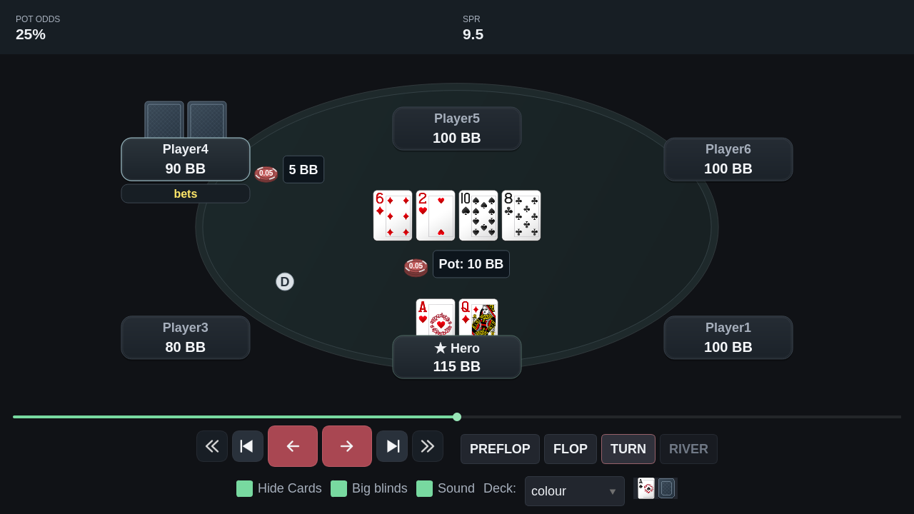
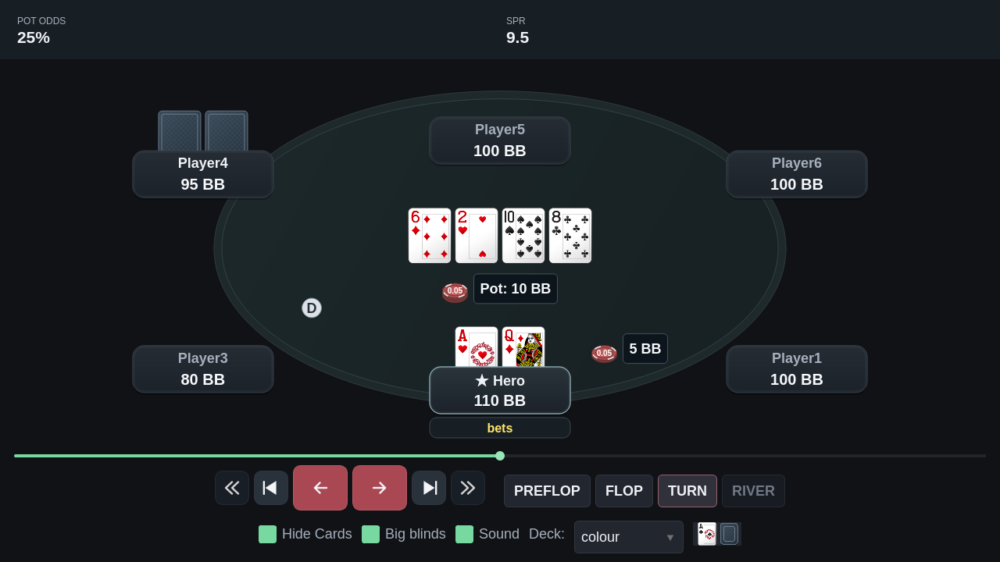

# Barra mínima: Pot odds e SPR

A barra superior ocupa toda a largura, sem margem externa, borda ou cantos
arredondados. Ela contém somente duas colunas, com títulos e posições fixos:

| POT ODDS | SPR |
| --- | --- |
| 25% | 9.5 |

Não há coluna de aposta do Hero, sizing, MDF, FE mínima, nomes, street,
stack efetivo, subtítulos ou tooltips na barra. Somente os valores mudam.
Zeros decimais desnecessários são removidos; um SPR multiway pode aparecer
como `50–65`. Sem uma decisão de call aplicável, pot odds mostra `—`.

## Jogador com a ação

Pot odds e SPR referem-se ao jogador que tem a próxima decisão na street
exibida. Depois de uma aposta do Hero, por exemplo, as pot odds são do
adversário que vai responder.

A sequência do replay identifica somente o nome de quem age a seguir.
O tamanho de sua ação futura e suas cartas não entram no cálculo. A busca
não atravessa para outra street nem trata um resultado como nova decisão.

- Pot odds: call limitado ao stack disponível, dividido pelo pote elegível
  após o call. Dinheiro de side pots que o jogador não pode ganhar é excluído.
- SPR: stack efetivo no início da street dividido pelo pote daquele momento.
  Em multiway, aparece a faixa dos confrontos efetivos por adversário.
- Sem próxima ação, pot odds fica vazio (`—`) e o SPR do Hero permanece
  como referência da street quando pode ser calculado.

## Verificação

- **245 testes direcionados aprovados**, incluindo cartas, fichas, layout,
  navegação, BB, áudio, variantes e aritmética de decisão.
- Testes específicos conferem a troca de Hero para adversário, a ausência
  de dependência do tamanho da ação futura e o limite de street.
- Teste Qt exige exatamente `POT ODDS\n25%` e `SPR\n50–65`, sem legendas
  extras; os mesmos títulos permanecem quando o valor é `—`.
- Ruff e mypy aprovados nos módulos alterados.
- Capturas públicas em 1280×720, 1600×900 e 1260×1380, incluindo Hero e
  adversário enfrentando aposta de meio pote, multiway, fold e side pots.

```bash
QT_QPA_PLATFORM=offscreen .venv/bin/python tools/capture_replayer_review.py \
  --out /tmp/replayer-two-metrics --big-blinds --decision-cases \
  --bet-cases --side-pots --polish-cases \
  --pokerstars-path "/caminho/absoluto/para/PokerStars"
```




